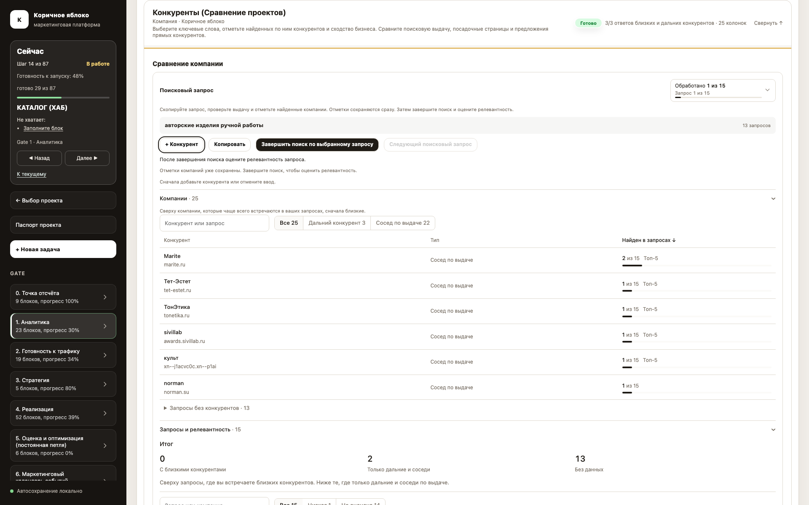
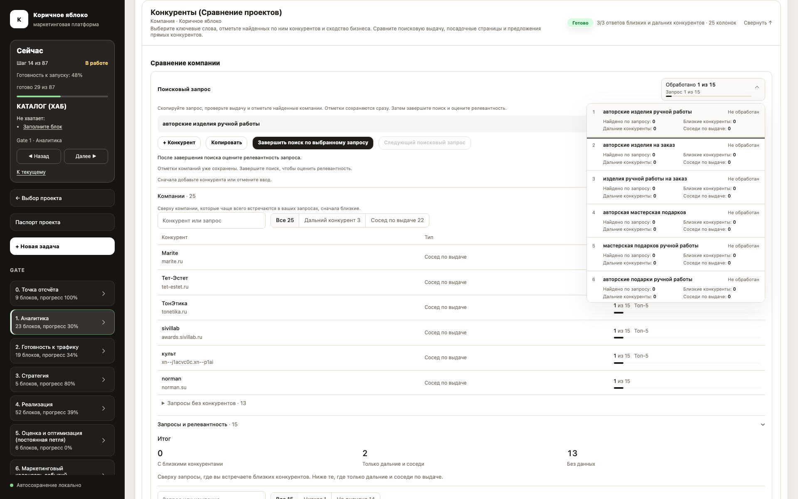
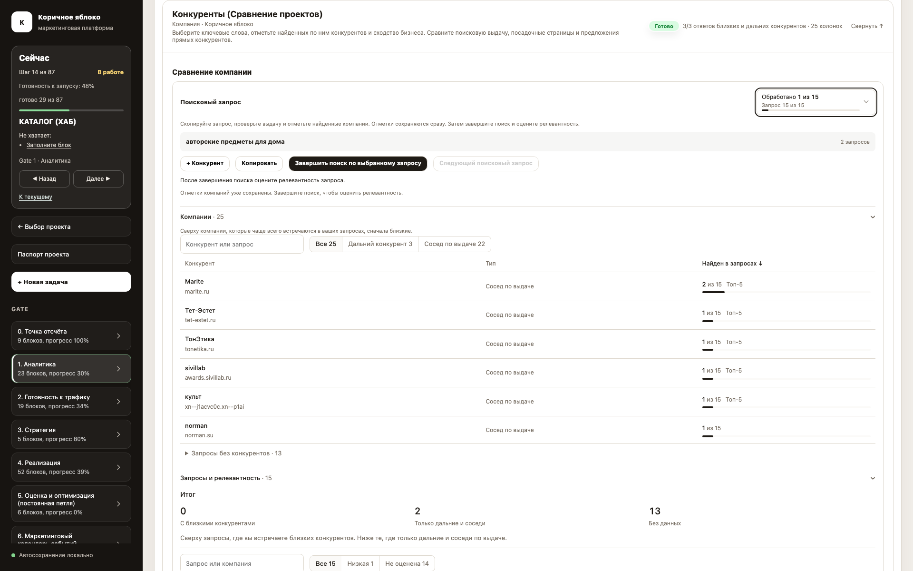
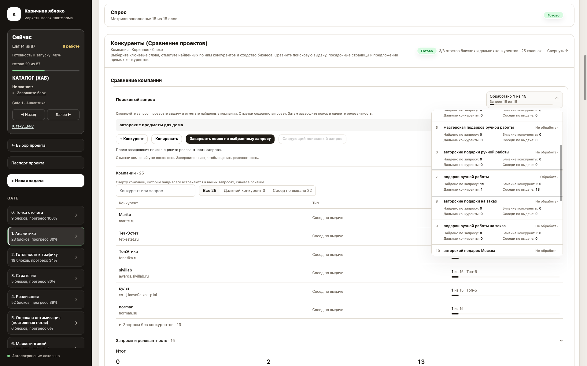

# Навигация по поисковым запросам

## Реализация

Счётчик «Оценено X из Y» заменён в шапке блока «Поисковый запрос» на кнопку с количеством обработанных запросов, номером текущего запроса и полосой прогресса. Запрос считается обработанным, когда его поиск завершён и релевантность оценена. Номер соответствует порядку в исходном списке запросов.

Кнопка открывает прокручиваемый список всех запросов. Каждая строка показывает число найденных компаний и распределение по близким, дальним конкурентам и соседям по выдаче из существующих связей. Выбор переключает только текущий запрос в состоянии экрана. Данные проекта не записываются. Если открыта форма конкурента с незавершённым вводом, переключение отклоняется с существующей подсказкой, введённое остаётся в форме.

Список поддерживает Enter/Space через обычные кнопки, стрелки, Home/End, Escape и закрытие по клику снаружи. Фокус после выбора и Escape возвращается на кнопку. Если снизу экрана не хватает места, список открывается вверх. Оформление использует `--surface`, `--panel-soft`, `--line`, `--accent`, `--accent-soft`, `--text`, `--muted`, `--shadow` и основной шрифт приложения.

Решение основано на рекомендациях Apple: [Pop-up buttons](https://developer.apple.com/design/human-interface-guidelines/pop-up-buttons), [Popovers](https://developer.apple.com/design/human-interface-guidelines/popovers/), [Progress indicators](https://developer.apple.com/design/human-interface-guidelines/progress-indicators/), [Focus and selection](https://developer.apple.com/design/human-interface-guidelines/focus-and-selection/). Состояние раскрытия соответствует [W3C Disclosure Pattern](https://www.w3.org/WAI/ARIA/apg/patterns/disclosure/).

## Проверки

- Изолированная сборка: `2.3.526+139ac9e4699a`, 49 ресурсов, успешно.
- `gate1-company-search-guide-smoke.mjs`: прежний сценарий поиска, отметок компаний, завершения и оценки прошёл.
- `gate1-company-query-nav-smoke.mjs`: четыре проекта прошли. Для «Коричное яблоко» проверены 15 запросов, для iCleaning 23; в экспортных снимках SIVRCE и «УНИВЕРСАЛ / ГУРУ» подтверждено пустое состояние без запросов.
- У всех четырёх проектов сериализованное состояние до и после действий совпадает побайтно как строка JSON, включая поля времени. Готовность сравнения при навигации не меняется. Проверены все показатели строк, клавиатурное управление, возврат фокуса, сохранение черновика формы и размещение списка у нижнего края окна.
- Синтаксис JS и `git diff --check`: успешно.

Экспорт «Коричное яблоко» в тесте содержит 1 обработанный запрос из 15 и 25 компаний. Он отличается от состояния 15 из 16 на приложенном пользователем снимке; текущий облачный проект тест не изменялся.

Push и публикация не выполнялись.

## Снимки экрана

