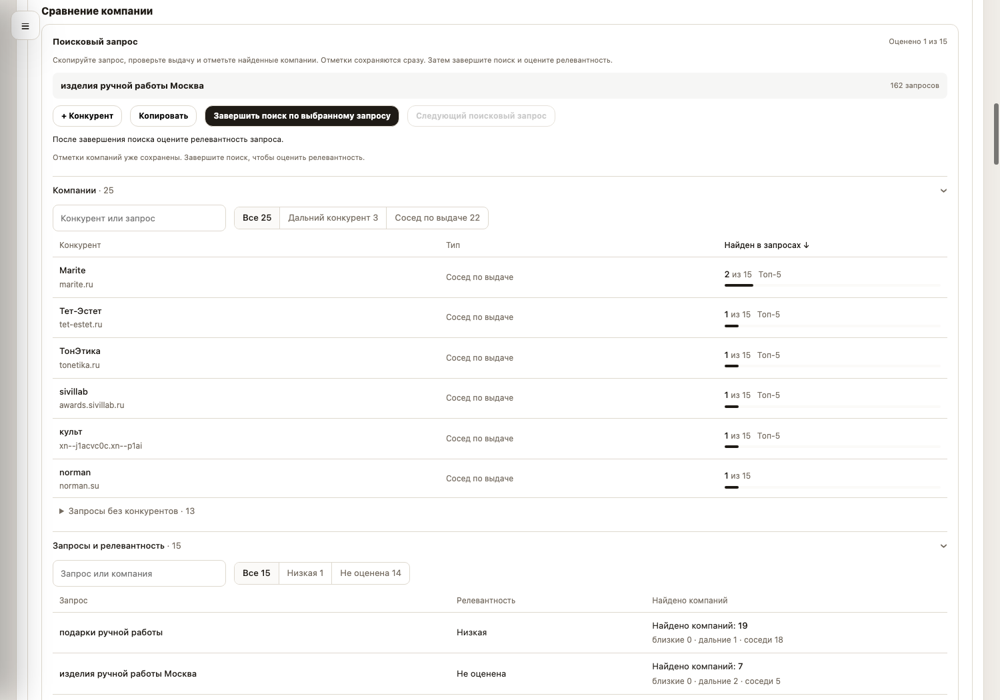
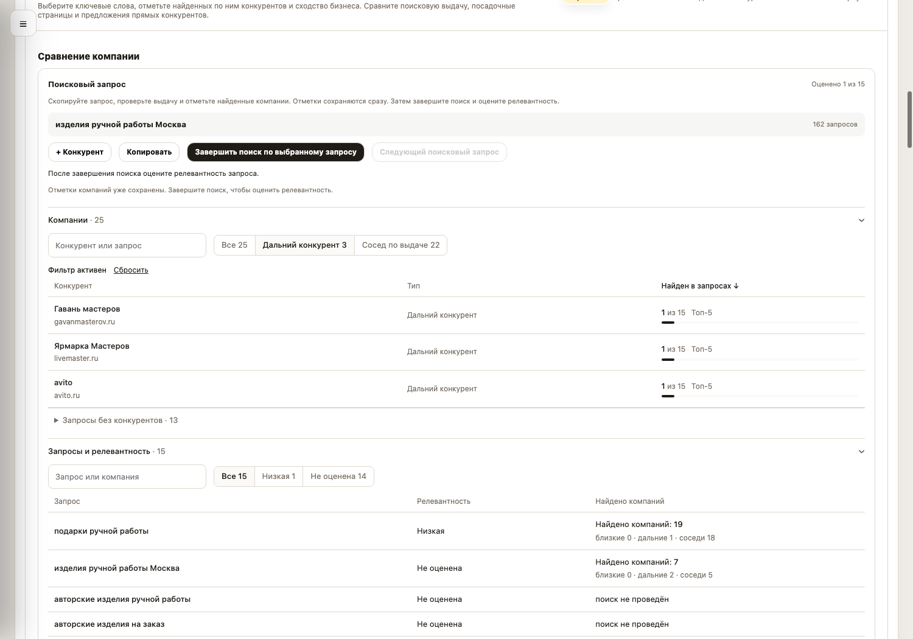
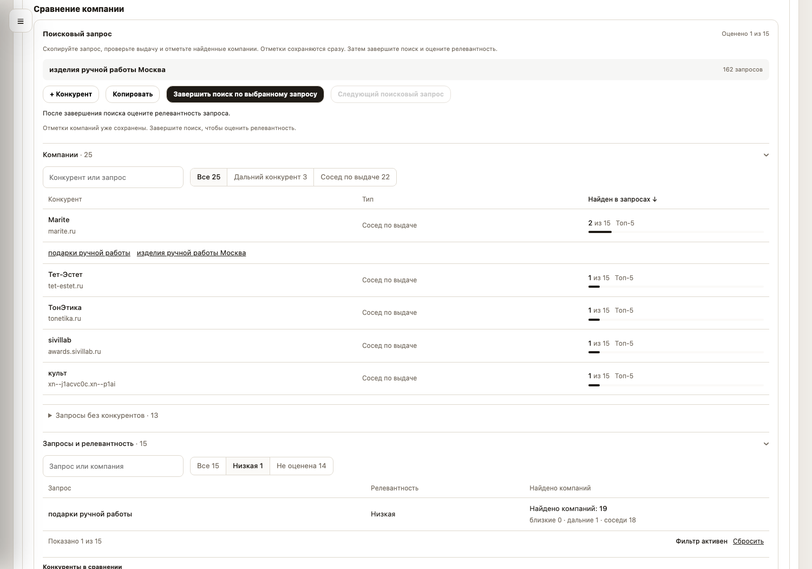

# Gate 1: порядок и вид сегментов

## Изменения

- Сегменты компаний идут в порядке «Все», «Близкий конкурент», «Дальний конкурент», «Сосед по выдаче», затем остальные типы из данных. Отсутствующие типы не выводятся; у каждого видимого сегмента показано число компаний. В проекте «Коричное яблоко» это «Все 25», «Дальний конкурент 3», «Сосед по выдаче 22».
- Сегменты запросов сохраняют порядок «Все», «Высокая», «Средняя», «Низкая», «Не оценена»; нулевые сегменты скрыты, числа показаны у всех видимых. В этом проекте есть «Все 15», «Низкая 1», «Не оценена 14».
- По умолчанию компании упорядочены по числу найденных запросов по убыванию. Для запросов подготовленная экранная копия списка упорядочена по релевантности от высокой к низкой, затем по числу найденных компаний по убыванию; «Не оценена» последняя. Функции `derive` и сортировка по нажатию на заголовки не менялись.
- У обоих наборов сегментов контур и разделители имеют одинаковую тонкую границу `0.5px` с токеном `--line`. Активное значение выделено только `--panel-soft`, основным цветом текста и весом 500.

## Проверки

Сборка `2.3.526+8b3ff1096f58` прошла; совпали 49 файлов. Смоук двух раскрывашек проверил порядок и числа сегментов, порядок строк, действия в обеих раскрывашках, неизменность DOM вне них, процента Gate 1, текущего шага и «Не хватает». На четырёх проектах `JSON.stringify(state)` до и после всех действий совпал целиком, включая поля времени:

| Проект | Компаний | Запросов | SHA-256 состояния до = после | Gate 1 до = после |
| --- | ---: | ---: | --- | ---: |
| Коричное яблоко | 25 | 15 | `e109fe7de01a0deb8de35386b1e2eab864e7ab41e5f0e897d5c69d51f9a75119` | 28% |
| iCleaning | 3 | 0 | `c742dde386d2b5212359929b51e34c138fe5daa4fd6d8ccd86036113c5a840e8` | 27% |
| SIVRCE | 3 | 0 | `5ad3eed8f7061119710a8522fef32c9ca386e5ee2a21758f537ccce2f70e14e4` | 7% |
| УНИВЕРСАЛ / ГУРУ | 0 | 0 | `ec8bee48d663fd516d9bb9a0f953ee4a609c108e247f8dc0c344e5ca993aafad` | 2% |

Подробные результаты, включая хеши исходных файлов и путеводитель, сохранены в `smoke-results.json`. Профильные смоуки `gate1-company-keyword-filter`, `gate1-company-search-guide`, `gate1-company-analysis`, `gate1-company-analysis-projects` и отдельный `gate1-comparison-performance` прошли. Проверка на проекте «Коричное яблоко» с запретом вызова `g1CompanyComparisonEntry(true)` тоже прошла: действия в раскрывашках не вызвали запись. Её результат сохранён в `trace/smoke-results.json`.

## Скриншоты

Обе раскрывашки с новым порядком доступных значений и числами:

Активный сегмент компаний:

Активный сегмент запросов:

Push и публикация не выполнялись.
