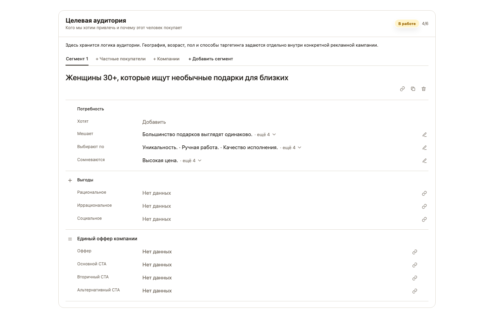
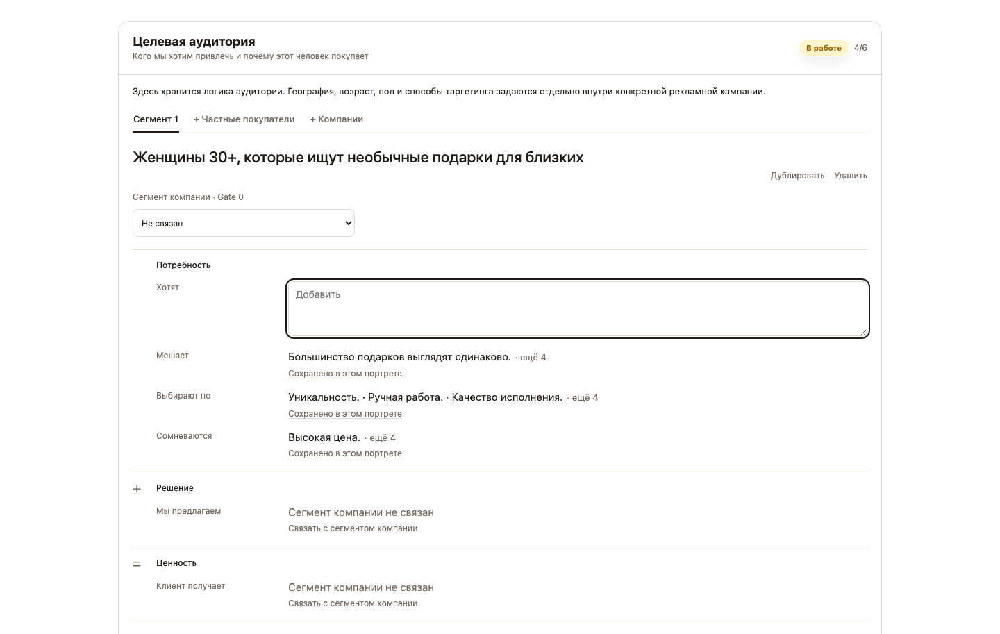
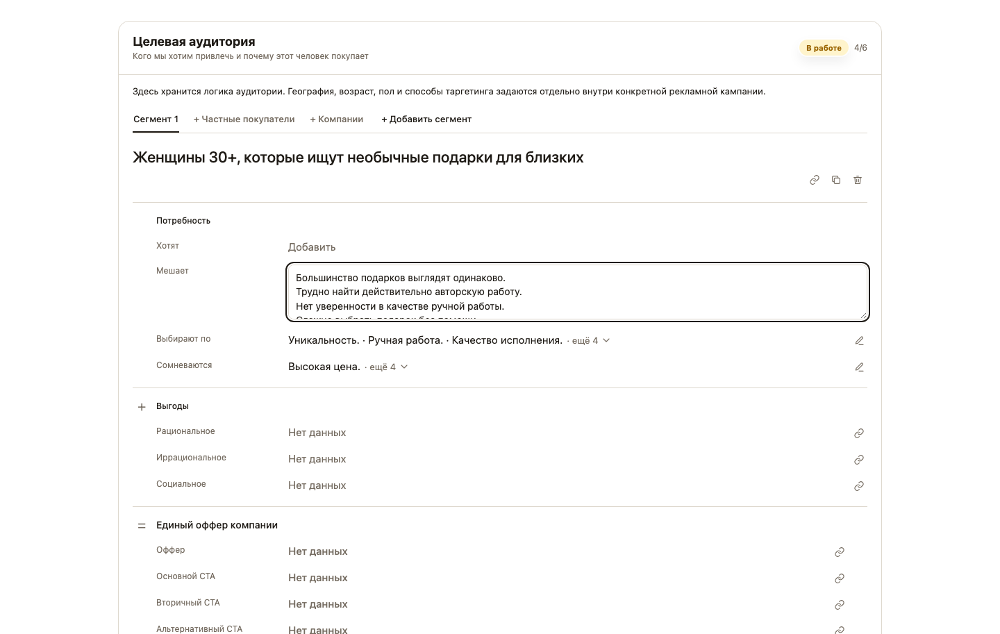
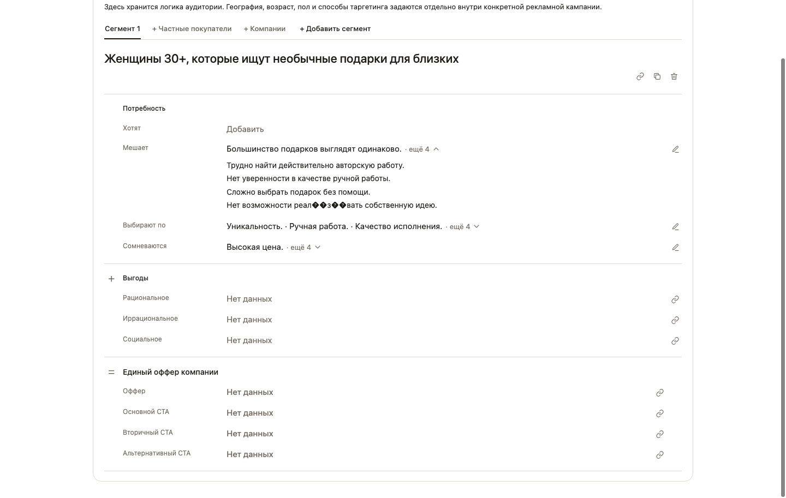
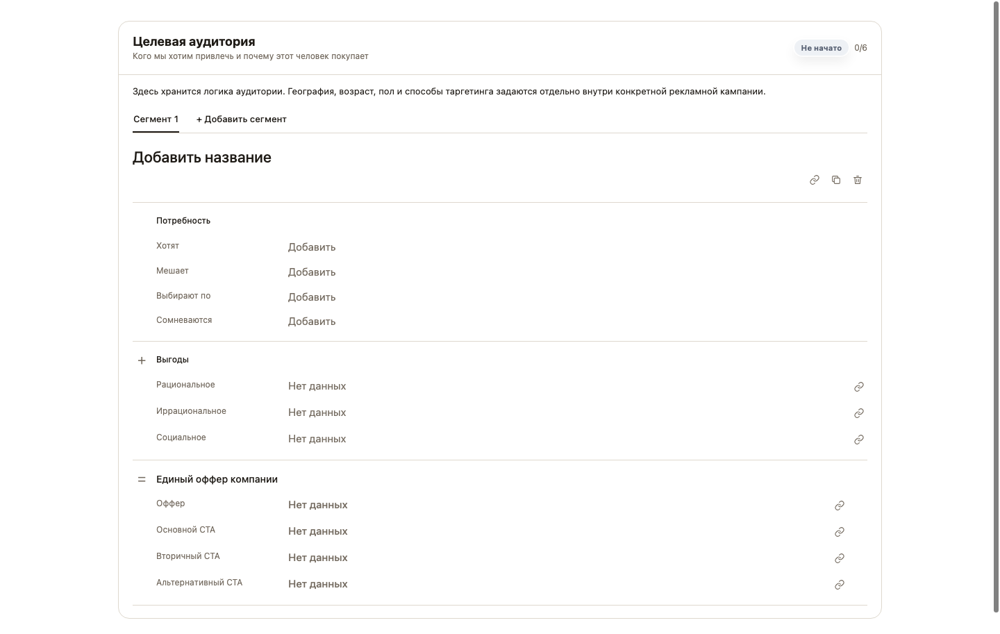
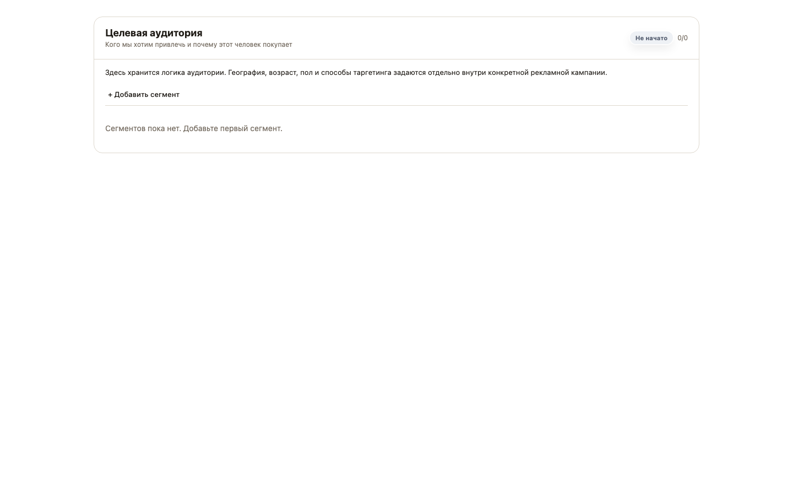
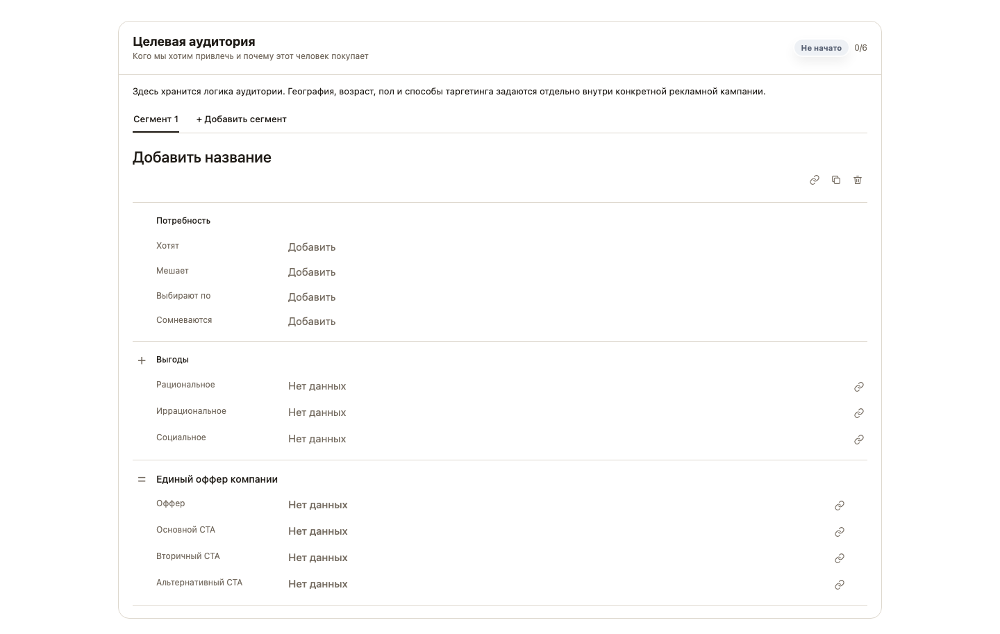

# Gate 1 / Компания / Целевая аудитория

## Изменение

- Новое представление вынесено в `gate1-company-target-audience.js` и `.css`; старая разметка, обработчики записи при вводе и CSS удалены. В `app.js` оставлена точка вызова и расчёт шести обязательных полей.
- Вкладки переключают сегменты; зоны, строки и редактор работают с текущим состоянием экрана. Раскрытие строки заменяет только её DOM. Значение сохраняется при потере фокуса, если оно изменилось; при вводе проект не обновляется.
- `who` и `need` остаются в модели, но не участвуют в готовности; значения и флаги `manualFields` не изменены при просмотре.
- Внешние обработчики навигации и массового сворачивания используют экранное состояние аудитории.

## Связь с Gate 0

Проверены исходные записи четырёх проектов. В `company_offer.segment_id` действительно хранится `id` записи Gate 0 `segments`. В сегментах Gate 1 нет ссылки на этот `id`; их собственные `id` не совпадают. В «Коричном яблоке» две активные записи сегментов Gate 0 и два связанных предложения; в Gate 1 один сегмент с другим `id`. В остальных трёх снимках активных проектных сегментов Gate 0 нет. Сопоставление по названию неоднозначно и не было введено. Поэтому вкладки `+ {segment_name}`, география из конкретного сегмента и значения «Клиент получает» не показываются как связанные. Вместо отсутствующего предложения показаны «Заполняется в Gate 0» и переход к источнику. Эти два сценария нельзя честно показать на скриншотах без изменения схемы данных.

## Готовность и хэши

Сравнение выполнено на фиксированных снимках проектов; числа текущего рабочего проекта могут отличаться от снимков. Старый и новый статус блока в каждом проекте совпал, поэтому проценты Gate 1 и готовности к запуску не изменились.

| Проект | Блок до → после | Gate 1 до → после | Запуск до → после | Хэш до = после |
|---|---:|---:|---:|---|
| Коричное яблоко | 8/8 → 6/6 | 27% → 27% | 48% → 48% | `7d84fbc692c3aee0…` = `7d84fbc692c3aee0…` |
| iCleaning | 5/8 → 3/6 | 28% → 28% | 36% → 36% | `c45e804d46b0c356…` = `c45e804d46b0c356…` |
| SIVRCE | 5/8 → 3/6 | 7% → 7% | 24% → 24% | `ace01a0c67812e86…` = `ace01a0c67812e86…` |
| УНИВЕРСАЛ / ГУРУ | 0/0 → 0/0 | 2% → 2% | 5% → 5% | `1b993573dc4fcd1b…` = `1b993573dc4fcd1b…` |

Итог по статусам панели «Сейчас» и «Не хватает» не меняется: переход `8/8 → 6/6` остаётся «Готово», `5/8 → 3/6` остаётся «В работе», проект без сегментов остаётся «Не начато».

В сохранённом `targetAudience.segments[0].problem` проекта «Коричное яблоко» найдено `Нет возможности реал��з��вать собственную идею.` Символы U+FFFD сохранены без исправления или фильтрации.

## Проверки

- `npm run build`: прошёл, сборка `2.3.526+ccc34b601b64`.
- `node scripts/gate1-company-target-audience-smoke.mjs`: все 4 проекта PASS, в том числе проект без сегментов и пустой сегмент.
- Сериализованный `state` после просмотра, раскрытия, открытия редактора, ввода несохранённого черновика и закрытия редактора идентичен исходному на всех четырёх проектах. Файлы снимков проектов не записывались.
- Раскрытие JTBD сохранило тот же DOM-узел соседней строки. Поиск старых классов, функций и текстов `target-audience-card`, `target-audience-fields`, `target-audience-sync`, `targetAudienceFieldHtml`, `targetAudienceCardHtml`, `targetAudienceUpdateInput`, `TARGET_AUDIENCE_GROUPS`, `Автозаполнение включено`, `Идентификация`, `Выбор решения` в активном коде дал 0 совпадений.
- Общие стили полей рекламной кампании оставлены; область «Продукт / Услуга» не изменялась.

## Снимки

### Сегмент, строки свёрнуты

### Раскрытый JTBD

### Редактор на месте

### Источник Gate 0 без связи

### iCleaning

### Проект без сегментов

### Пустой сегмент

