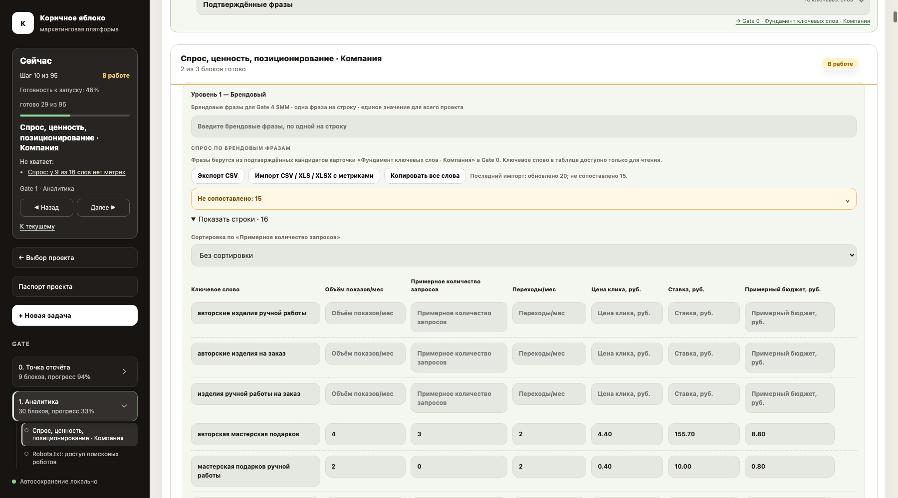
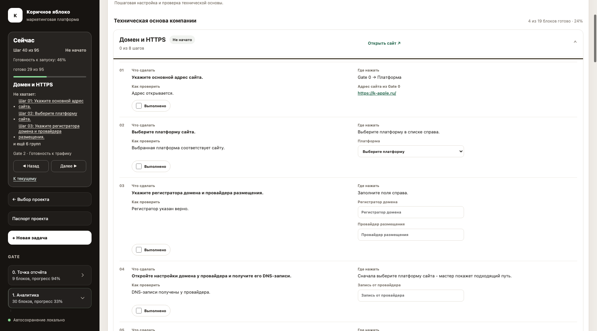
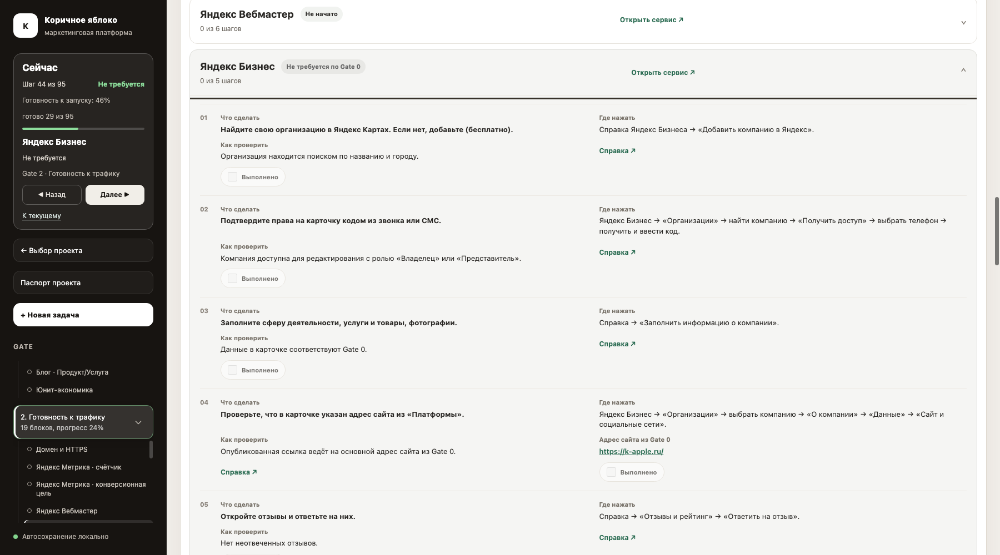

# Путеводитель, шаг 3: Gate 1 и Gate 2

## Сборка

- Локальный коммит перед работой: `dd9a7f0fec0770e8a259ba1e78786db17de7c008`.
- Сообщение коммита: «Путеводитель: Gate 0, шаги 1-2». Push не выполнялся.
- Проверенная сборка: `2.3.526+bda55d5fcf45`.
- SHA-256 содержимого runtime: `bda55d5fcf453e1f53e7d6cf36805ce59a395d937eee5ff52177b31c2605c8ff`.
- Изменения шага 3 находятся в рабочем дереве относительно указанного коммита.
- `npm run build` выполнен на отдельной локальной копии исходников: PASS, 42 согласованных JS/CSS ресурса. Корневые index.html и build-info.js не перезаписывались.

## Результат

Проверка выполнена на изолированной тестовой копии существующего экспорта Коричного яблока. Выбранный product_id: `catalog-item-1786792591872-51f503`.

| Гейт | total | done | В работе | Проблема | Не начато | Процент |
| --- | --- | --- | --- | --- | --- | --- |
| Gate 1 | 30 | 5 | 6 | 4 | 15 | 33% |
| Gate 2 | 19 | 4 | 1 | 0 | 14 | 24% |

Для каждого блока совпали значок на странице и канонический статус пути. Обе суммы total/done совпали с navigationReadiness из экспортной диагностики. Done включает «Готово» и «Не требуется». Процент использует существующую формулу: round(100 × (done + 0,5 × (inProgress + problem)) / total).

Gate 2: четыре блока с причиной «Не требуется» входят в путь и считаются готовыми. Все 19 позиций пути имеют видимые редакторы; старые карточки «Дополнительных настроек» не включены. В Gate 1 исключены сводки Meta Robots и CWV без собственного редактора, включён существующий редактор «Собственный интерактивный инструмент».

Строка «Не хватает» содержит до трёх пунктов и остаток «и ещё N». Клик в Gate 1 ведёт к полю, в Gate 2 раскрывает и подсвечивает существующий шаг. Пять готовых блоков Gate 1 возвращают «Всё заполнено», четыре необязательных блока Gate 2 возвращают «Не требуется». Для доступных позиций пути Gate 3 и далее строка отсутствует.

## Таблица Gate 1

| id | Название | Значок на странице | Статус пути | total/done |
| --- | --- | --- | --- | --- |
| company_demand_positioning | Спрос, ценность, позиционирование · Компания | В работе | В работе | 1/0 |
| card-14 | Robots.txt: доступ поисковых роботов | Проблема | Проблема | 1/0 |
| card-16 | Канонический URL и редиректы | Готово | Готово | 1/1 |
| card-20 | SSL / HTTPS: безопасность домена | Проблема | Проблема | 1/0 |
| project-comparison | Сравнение проекта | В работе | В работе | 1/0 |
| gate1-seo-v300-company-webmaster | Яндекс Вебмастер · Компания | Проблема | Проблема | 1/0 |
| interactive-tool | Собственный интерактивный инструмент | Не начато | Не начато | 1/0 |
| card-21 | ГЛАВНАЯ | Готово | Готово | 1/1 |
| card-22-hub | КАТАЛОГ (ХАБ) | В работе | В работе | 1/0 |
| card-22 | КАТЕГОРИЯ | В работе | В работе | 1/0 |
| card-25 | СТАТЬЯ БЛОГА | В работе | В работе | 1/0 |
| card-26 | О НАС | Не начато | Не начато | 1/0 |
| card-27 | КОНТАКТЫ | Не начато | Не начато | 1/0 |
| card-28 | ДОСТАВКА / ГАРАНТИИ | Не начато | Не начато | 1/0 |
| card-30 | 404 | Не начато | Не начато | 1/0 |
| card-31 | THANK YOU PAGE | Не начато | Не начато | 1/0 |
| card-32 | ЛЕНДИНГ | Не начато | Не начато | 1/0 |
| card-site-header-v497 | ХЕДЕР | Не начато | Не начато | 1/0 |
| card-site-footer-v497 | Футер: навигация, доверие и юридическая база | Не начато | Не начато | 1/0 |
| card-29 | ПОЛИТИКА | Не начато | Не начато | 1/0 |
| card-35 | Cookie-баннер: уведомление и согласие | Не начато | Не начато | 1/0 |
| card-36 | Футер: навигация, доверие и юридическая база | Не начато | Не начато | 1/0 |
| card-37 | Согласие в формах | Не начато | Не начато | 1/0 |
| target-audience | Целевая аудитория | Готово | Готово | 1/1 |
| gate1-blog-v304-company | Блог · Компания | В работе | В работе | 1/0 |
| card-24 | КАРТОЧКА ТОВАРА | Готово | Готово | 1/1 |
| gate1-seo-v300-product-webmaster | Яндекс Вебмастер · Продукт/Услуга | Проблема | Проблема | 1/0 |
| pain_jtbd_offer | Спрос, ценность, позиционирование · Продукт/Услуга | Готово | Готово | 1/1 |
| gate1-blog-v304-product | Блог · Продукт/Услуга | Не начато | Не начато | 1/0 |
| unit-economics | Юнит-экономика | Не начато | Не начато | 1/0 |
| Итого | 33% | Совпали все 30 | navigationReadiness совпадает | **30/5** |

## Таблица Gate 2

| id | Название | Значок на странице | Статус пути | total/done |
| --- | --- | --- | --- | --- |
| company-domain | Домен и HTTPS | Не начато | Не начато | 1/0 |
| company-counter | Яндекс Метрика · счётчик | Не начато | Не начато | 1/0 |
| company-goal | Яндекс Метрика · конверсионная цель | Не начато | Не начато | 1/0 |
| company-webmaster | Яндекс Вебмастер | Не начато | Не начато | 1/0 |
| company-yandex-business | Яндекс Бизнес | Не требуется по Gate 0 | Не требуется | 1/1 |
| company-yandex-direct | Яндекс Директ · кабинет | Не начато | Не начато | 1/0 |
| company-vk | VK Реклама и пиксель | В работе | В работе | 1/0 |
| company-telegram-ads | Telegram Ads · кабинет | Не начато | Не начато | 1/0 |
| company-meta-ads | Meta Ads · кабинет и пиксель | Не требуется: все каналы отмечены «Не требуется» в Gate 0 | Не требуется | 1/1 |
| company-ga4 | Google Analytics 4 | Не начато | Не начато | 1/0 |
| company-gsc | Google Search Console | Не требуется по Gate 0 | Не требуется | 1/1 |
| company-google-ads | Google Ads · конверсии | Не требуется: все каналы отмечены «Не требуется» в Gate 0 | Не требуется | 1/1 |
| company-leads | Приём заявок | Не начато | Не начато | 1/0 |
| company-safety | Юридическая защита | Не начато | Не начато | 1/0 |
| product-landing | Посадочная товара | Не начато | Не начато | 1/0 |
| product-counter | Метрика продукта · визит | Не начато | Не начато | 1/0 |
| product-goal | Метрика продукта · цель | Не начато | Не начато | 1/0 |
| product-vk | События VK Рекламы | Не начато | Не начато | 1/0 |
| product-lead | Сквозная проверка заявки | Не начато | Не начато | 1/0 |
| Итого | 24% | Совпали все 19 | navigationReadiness совпадает | **19/4** |

Причина после «Не требуется» остаётся текстом значка на странице. В пути эти варианты нормализованы в not_required. Продуктовые позиции рассчитаны для указанного product_id.

## Неизменность данных

Полный экспорт workspace сравнивался побайтно до холодного открытия Gate 1 и после всех 49 переходов, кликов по подсказкам и снимков экрана.

- До: 28081766 байт.
- После: 28081766 байт.
- SHA-256 до: `cc4cb982f978f64e51a009ff21637133c267d84000dbef9317053d3b659031eb`.
- SHA-256 после: `cc4cb982f978f64e51a009ff21637133c267d84000dbef9317053d3b659031eb`.
- Различий: 0. В сравнении участвуют все 259 полей updated_at, а также updatedAt и остальные данные workspace.
- Записей предпочтений раскрытия: 0.

Устранены побочные записи при чтении: нормализация редакторов и отложенные сохранения работают с временным представлением. Начальные сообщения встроенного калькулятора при открытии через путеводитель не записывают его значения по умолчанию в проект.

После сравнения отдельно проверено редактирование на копии в памяти: пункт «Спрос: авторские изделия ручной работы, Объём показов/мес» исчез после ввода. Изменение цены во встроенном калькуляторе дошло до экономики. Исходное состояние восстановлено побайтно. Новых сохраняемых полей и хранилищ нет.

## Общая подсказка «Заполните блок»

В текущих данных для следующих 16 блоков Gate 1 расчёт не вернул адрес конкретного доступного редактируемого поля. Кнопка открывает сам блок. Для Gate 2 таких блоков нет.

| Гейт | id | Название |
| --- | --- | --- |
| Gate 1 | card-14 | Robots.txt: доступ поисковых роботов |
| Gate 1 | card-22-hub | КАТАЛОГ (ХАБ) |
| Gate 1 | card-25 | СТАТЬЯ БЛОГА |
| Gate 1 | card-26 | О НАС |
| Gate 1 | card-27 | КОНТАКТЫ |
| Gate 1 | card-28 | ДОСТАВКА / ГАРАНТИИ |
| Gate 1 | card-30 | 404 |
| Gate 1 | card-31 | THANK YOU PAGE |
| Gate 1 | card-32 | ЛЕНДИНГ |
| Gate 1 | card-site-header-v497 | ХЕДЕР |
| Gate 1 | card-site-footer-v497 | Футер: навигация, доверие и юридическая база |
| Gate 1 | card-29 | ПОЛИТИКА |
| Gate 1 | card-35 | Cookie-баннер: уведомление и согласие |
| Gate 1 | card-36 | Футер: навигация, доверие и юридическая база |
| Gate 1 | gate1-seo-v300-product-webmaster | Яндекс Вебмастер · Продукт/Услуга |
| Gate 1 | unit-economics | Юнит-экономика |

## Проверки

- `node scripts/gate12-now-readiness-smoke.mjs`: PASS, 49 переходов, 49 совпадений значков и пути, обе матрицы совпали с navigationReadiness.
- Переход к пустому полю Gate 1: фокус, видимость и подсветка подтверждены.
- Gate 2: «Домен и HTTPS», Шаг 03 раскрыт, виден и подсвечен; «Яндекс Бизнес» показывает «Не требуется», «Далее» выделена.
- Проверка ввода и передачи расчёта на отдельной копии в памяти: PASS.
- Контрольный `scripts/gate0-unified-readiness-smoke.mjs`: PASS. Запущена копия скрипта, изменён только префикс выходных артефактов на /private/tmp. Gate 0: 9 блоков, 8 готово, 94%; экспорт идентичен в обоих сценариях.
- `node --check`: PASS для восьми изменённых runtime-файлов и нового smoke.
- `git diff --check`: PASS.
- Локальная сборка: PASS.

## Изменённые файлы

Относительно коммита dd9a7f0fec0770e8a259ba1e78786db17de7c008:

| Файл | Изменение |
| --- | --- |
| app.js | Диагностика пустот в существующих расчётах Gate 1: страницы, SSL, согласия, сравнение, аудитория, экономика и спрос. |
| gate1-blog-system.js | Пустоты выдаёт действующая проверка готовности статьи и связи с выбранным продуктом. |
| gate1-seo-interactive-tool.js | Пустоты выдаёт действующий расчёт инструмента. |
| gate1-webmaster-qa.js | Диагностика полей проверки сайта и ошибок обхода. |
| gate2-product-services-step4.js | Порядок видимых блоков, включение «Не требуется» в done, общие показатели и диагностика. |
| gate2-service-block.js | Диагностика невыполненных шагов из текущего расчёта. |
| gate2-setup-wizard.js | Общий расчёт по видимым шагам для статуса и подтверждения. |
| now-guide.js | Реестр Gate 1, провайдеры пустот Gate 1/2, переходы, фокус и подсветка, защита чтения от сохранений. |
| scripts/gate12-now-readiness-smoke.mjs | Проверка 49 блоков, диагностики, переходов, экспорта и редактирования на копии. |

Добавленные материалы проверки: `artifacts/gate12-now-readiness-*.png`, `*-results.json`, `*-build.json`, `*-smoke.log`, `*-gate0-regression-results.json`, `*-gate0-regression.log`, этот отчёт.

## Скриншоты

Процент Gate 1 (33%) виден на первом снимке, Gate 2 (24%) на втором и третьем.

### Gate 1: карточка и переход к полю

Путь: `artifacts/gate12-now-readiness-gate1-field.png`.

### Gate 2: карточка и Шаг 03

Путь: `artifacts/gate12-now-readiness-gate2-step03.png`.

### Gate 2: «Не требуется»

Путь: `artifacts/gate12-now-readiness-gate2-not-required.png`.

## Что не проверено

- Другие проекты и переключение на другой product_id в этом шаге.
- Редактирование каждого из 49 блоков; проверены все переходы и статусы, ввод в поле спроса и во встроенном калькуляторе.
- Работа внешних API, облачная синхронизация, мобильная вёрстка и другие браузеры.
- Полный исторический набор smoke-тестов остальных гейтов. Для Gate 3 и далее проверено отсутствие строки «Не хватает» в путеводителе.
