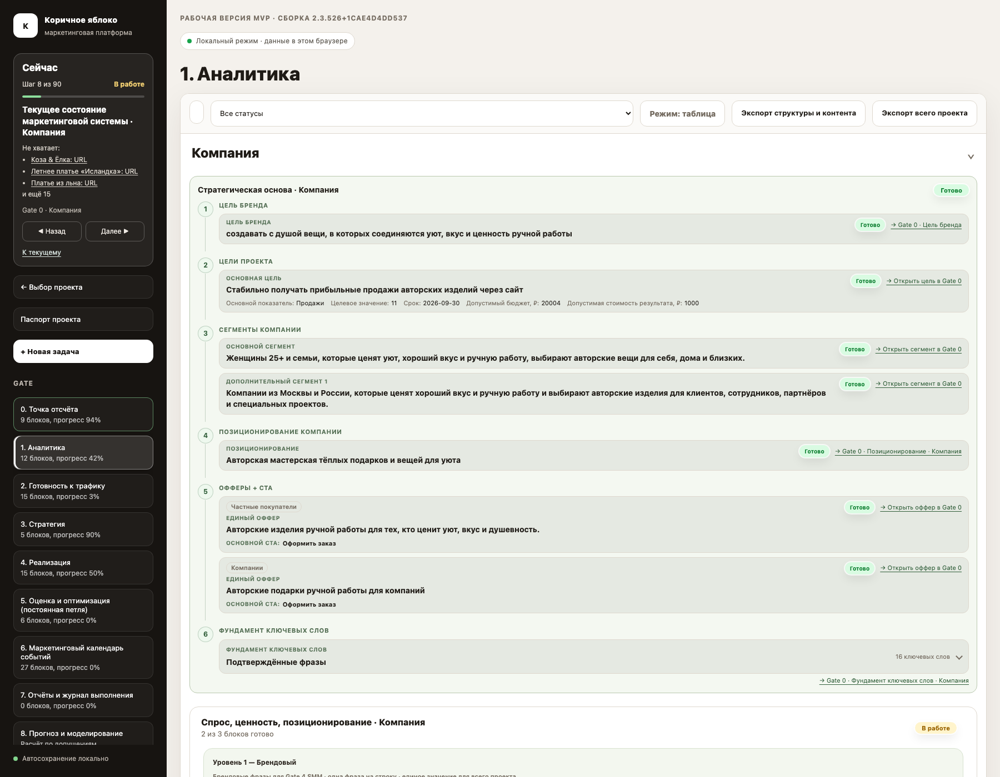
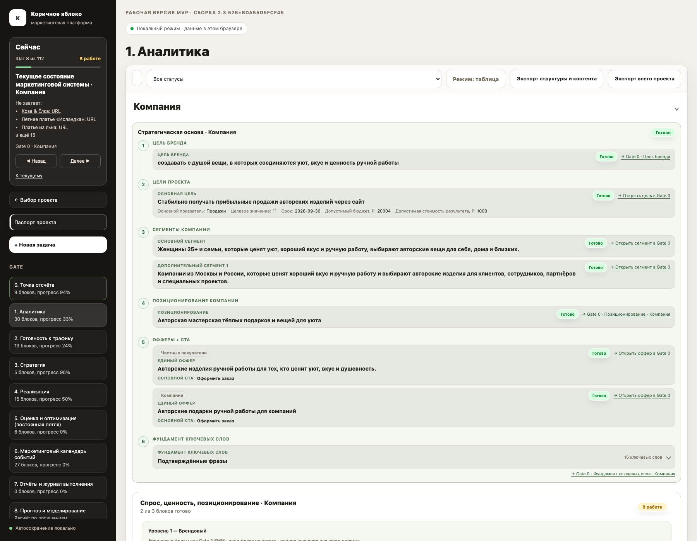

# Шаг 3.1: аудит роста Gate 1 и Gate 2

## Сборки и результат проверки

- До шага 3: локальный коммит `dd9a7f0fec0770e8a259ba1e78786db17de7c008`, сборка `2.3.526+1cae4d4dd537`.
- После шага 3: рабочее дерево, сборка `2.3.526+bda55d5fcf45`.
- SHA-256 runtime после: `bda55d5fcf453e1f53e7d6cf36805ce59a395d937eee5ff52177b31c2605c8ff`.
- В шаге 3.1 код расчёта не изменялся: ошибок двойного подсчёта или включения постоянно скрытого редактора проверка не нашла. Добавлен только smoke и материалы проверки.

## 1. Почему выросло число блоков

### Gate 1: 12 - 2 + 20 = 30

Старый реестр выбирал технические карточки по isTechCard и добавлял сравнение, аудиторию и юнит-экономику. В него не попадала большая часть существующих редакторов страницы. Новый реестр берёт видимые редакторы из getGate1Sections и существующие самостоятельные редакторы. Новых редакторов на странице шаг 3 не создавал.

Из расчёта исключены `card-17` (Meta Robots SEO META in 1 CLICK), `card-18` (CWV PageSpeed Insights). Это агрегированные сводки без собственного редактора, исходные записи сохранены.

Добавленные в расчёт 20 блоков:

| id | Название | Статус | Продуктовый | product_id / область |
| --- | --- | --- | --- | --- |
| company_demand_positioning | Спрос, ценность, позиционирование · Компания | В работе | Нет | Компания |
| gate1-seo-v300-company-webmaster | Яндекс Вебмастер · Компания | Проблема | Нет | Компания |
| interactive-tool | Собственный интерактивный инструмент | Не начато | Нет | Компания |
| card-21 | ГЛАВНАЯ | Готово | Нет | Компания |
| card-22-hub | КАТАЛОГ (ХАБ) | В работе | Нет | Компания |
| card-22 | КАТЕГОРИЯ | В работе | Нет | Компания |
| card-25 | СТАТЬЯ БЛОГА | В работе | Нет | Компания |
| card-26 | О НАС | Не начато | Нет | Компания |
| card-27 | КОНТАКТЫ | Не начато | Нет | Компания |
| card-28 | ДОСТАВКА / ГАРАНТИИ | Не начато | Нет | Компания |
| card-30 | 404 | Не начато | Нет | Компания |
| card-31 | THANK YOU PAGE | Не начато | Нет | Компания |
| card-32 | ЛЕНДИНГ | Не начато | Нет | Компания |
| card-site-header-v497 | ХЕДЕР | Не начато | Нет | Компания |
| card-29 | ПОЛИТИКА | Не начато | Нет | Компания |
| gate1-blog-v304-company | Блог · Компания | В работе | Нет | Компания |
| card-24 | КАРТОЧКА ТОВАРА | Готово | Да | catalog-item-1786792591872-51f503 |
| gate1-seo-v300-product-webmaster | Яндекс Вебмастер · Продукт/Услуга | Проблема | Да | catalog-item-1786792591872-51f503 |
| pain_jtbd_offer | Спрос, ценность, позиционирование · Продукт/Услуга | Готово | Да | catalog-item-1786792591872-51f503 |
| gate1-blog-v304-product | Блог · Продукт/Услуга | Не начато | Да | catalog-item-1786792591872-51f503 |

У общего блока «Юнит-экономика» также уточнился расчёт: раньше статус «В работе» читался из совокупности записей, без ограничения выбранным product_id. Сейчас выбран `catalog-item-1786792591872-51f503`, а статус «Не начато» получен по точному product_id. Это изменение статуса, количество позиций юнит-экономики осталось равным одному.

### Gate 2: 15 + 4 = 19

Раньше g2s4Readiness исключал status = not_needed. В шаге 3 эти существующие видимые редакторы вошли в total, а в done вошли как «Не требуется», согласно правилу задачи:

| id | Название | Статус | Продуктовый | product_id / область |
| --- | --- | --- | --- | --- |
| company-yandex-business | Яндекс Бизнес | Не требуется | Нет | Компания |
| company-meta-ads | Meta Ads · кабинет и пиксель | Не требуется | Нет | Компания |
| company-gsc | Google Search Console | Не требуется | Нет | Компания |
| company-google-ads | Google Ads · конверсии | Не требуется | Нет | Компания |

Старые карточки дополнительных настроек в путь не включены. Все позиции Gate 2 имеют kind service или wizard.

## Полные списки до и после

Для списков ниже выбран `catalog-item-1786792591872-51f503`, «Символ 2027 года “Коза”». Значение «Компания» означает отсутствие продуктового ключа у этого блока.

### Gate 1 до: 12 блоков, 2 готовы, 42%

| id | Название | Статус | Продуктовый | product_id / область |
| --- | --- | --- | --- | --- |
| card-14 | Robots.txt: доступ поисковых роботов | Проблема | Нет | Компания |
| card-16 | Канонический URL и редиректы | Готово | Нет | Компания |
| card-17 | Meta Robots SEO META in 1 CLICK | В работе | Нет | Компания |
| card-18 | CWV PageSpeed Insights | В работе | Нет | Компания |
| card-20 | SSL / HTTPS: безопасность домена | Проблема | Нет | Компания |
| project-comparison | Сравнение проекта | В работе | Нет | Компания |
| card-site-footer-v497 | Футер: навигация, доверие и юридическая база | Не начато | Нет | Компания |
| card-35 | Cookie-баннер: уведомление и согласие | Не начато | Нет | Компания |
| card-36 | Футер: навигация, доверие и юридическая база | Не начато | Нет | Компания |
| card-37 | Согласие в формах | Не начато | Нет | Компания |
| target-audience | Целевая аудитория | Готово | Нет | Компания |
| unit-economics | Юнит-экономика | В работе | Да | Все записи, без фильтра product_id |

### Gate 1 после: 30 блоков, 5 готовы, 33%

| id | Название | Статус | Продуктовый | product_id / область |
| --- | --- | --- | --- | --- |
| company_demand_positioning | Спрос, ценность, позиционирование · Компания | В работе | Нет | Компания |
| card-14 | Robots.txt: доступ поисковых роботов | Проблема | Нет | Компания |
| card-16 | Канонический URL и редиректы | Готово | Нет | Компания |
| card-20 | SSL / HTTPS: безопасность домена | Проблема | Нет | Компания |
| project-comparison | Сравнение проекта | В работе | Нет | Компания |
| gate1-seo-v300-company-webmaster | Яндекс Вебмастер · Компания | Проблема | Нет | Компания |
| interactive-tool | Собственный интерактивный инструмент | Не начато | Нет | Компания |
| card-21 | ГЛАВНАЯ | Готово | Нет | Компания |
| card-22-hub | КАТАЛОГ (ХАБ) | В работе | Нет | Компания |
| card-22 | КАТЕГОРИЯ | В работе | Нет | Компания |
| card-25 | СТАТЬЯ БЛОГА | В работе | Нет | Компания |
| card-26 | О НАС | Не начато | Нет | Компания |
| card-27 | КОНТАКТЫ | Не начато | Нет | Компания |
| card-28 | ДОСТАВКА / ГАРАНТИИ | Не начато | Нет | Компания |
| card-30 | 404 | Не начато | Нет | Компания |
| card-31 | THANK YOU PAGE | Не начато | Нет | Компания |
| card-32 | ЛЕНДИНГ | Не начато | Нет | Компания |
| card-site-header-v497 | ХЕДЕР | Не начато | Нет | Компания |
| card-site-footer-v497 | Футер: навигация, доверие и юридическая база | Не начато | Нет | Компания |
| card-29 | ПОЛИТИКА | Не начато | Нет | Компания |
| card-35 | Cookie-баннер: уведомление и согласие | Не начато | Нет | Компания |
| card-36 | Футер: навигация, доверие и юридическая база | Не начато | Нет | Компания |
| card-37 | Согласие в формах | Не начато | Нет | Компания |
| target-audience | Целевая аудитория | Готово | Нет | Компания |
| gate1-blog-v304-company | Блог · Компания | В работе | Нет | Компания |
| card-24 | КАРТОЧКА ТОВАРА | Готово | Да | catalog-item-1786792591872-51f503 |
| gate1-seo-v300-product-webmaster | Яндекс Вебмастер · Продукт/Услуга | Проблема | Да | catalog-item-1786792591872-51f503 |
| pain_jtbd_offer | Спрос, ценность, позиционирование · Продукт/Услуга | Готово | Да | catalog-item-1786792591872-51f503 |
| gate1-blog-v304-product | Блог · Продукт/Услуга | Не начато | Да | catalog-item-1786792591872-51f503 |
| unit-economics | Юнит-экономика | Не начато | Да | catalog-item-1786792591872-51f503 |

### Gate 2 до: 15 блоков, 0 готовы, 3%

| id | Название | Статус | Продуктовый | product_id / область |
| --- | --- | --- | --- | --- |
| company-counter | Яндекс Метрика · счётчик | Не начато | Нет | Компания |
| company-goal | Яндекс Метрика · конверсионная цель | Не начато | Нет | Компания |
| company-domain | Домен и HTTPS | Не начато | Нет | Компания |
| company-webmaster | Яндекс Вебмастер | Не начато | Нет | Компания |
| company-yandex-direct | Яндекс Директ · кабинет | Не начато | Нет | Компания |
| company-vk | VK Реклама и пиксель | В работе | Нет | Компания |
| company-telegram-ads | Telegram Ads · кабинет | Не начато | Нет | Компания |
| company-ga4 | Google Analytics 4 | Не начато | Нет | Компания |
| company-leads | Приём заявок | Не начато | Нет | Компания |
| company-safety | Юридическая защита | Не начато | Нет | Компания |
| product-landing | Посадочная товара | Не начато | Да | catalog-item-1786792591872-51f503 |
| product-counter | Метрика продукта · визит | Не начато | Да | catalog-item-1786792591872-51f503 |
| product-goal | Метрика продукта · цель | Не начато | Да | catalog-item-1786792591872-51f503 |
| product-vk | События VK Рекламы | Не начато | Да | catalog-item-1786792591872-51f503 |
| product-lead | Сквозная проверка заявки | Не начато | Да | catalog-item-1786792591872-51f503 |

### Gate 2 после: 19 блоков, 4 готовы или не требуются, 24%

| id | Название | Статус | Продуктовый | product_id / область |
| --- | --- | --- | --- | --- |
| company-domain | Домен и HTTPS | Не начато | Нет | Компания |
| company-counter | Яндекс Метрика · счётчик | Не начато | Нет | Компания |
| company-goal | Яндекс Метрика · конверсионная цель | Не начато | Нет | Компания |
| company-webmaster | Яндекс Вебмастер | Не начато | Нет | Компания |
| company-yandex-business | Яндекс Бизнес | Не требуется | Нет | Компания |
| company-yandex-direct | Яндекс Директ · кабинет | Не начато | Нет | Компания |
| company-vk | VK Реклама и пиксель | В работе | Нет | Компания |
| company-telegram-ads | Telegram Ads · кабинет | Не начато | Нет | Компания |
| company-meta-ads | Meta Ads · кабинет и пиксель | Не требуется | Нет | Компания |
| company-ga4 | Google Analytics 4 | Не начато | Нет | Компания |
| company-gsc | Google Search Console | Не требуется | Нет | Компания |
| company-google-ads | Google Ads · конверсии | Не требуется | Нет | Компания |
| company-leads | Приём заявок | Не начато | Нет | Компания |
| company-safety | Юридическая защита | Не начато | Нет | Компания |
| product-landing | Посадочная товара | Не начато | Да | catalog-item-1786792591872-51f503 |
| product-counter | Метрика продукта · визит | Не начато | Да | catalog-item-1786792591872-51f503 |
| product-goal | Метрика продукта · цель | Не начато | Да | catalog-item-1786792591872-51f503 |
| product-vk | События VK Рекламы | Не начато | Да | catalog-item-1786792591872-51f503 |
| product-lead | Сквозная проверка заявки | Не начато | Да | catalog-item-1786792591872-51f503 |

## 2. Проверка дублей и видимости

- В каждом списке Gate 1 и Gate 2 все id уникальны. У одного id нет двух позиций с продуктом и без него.
- Проверены заголовки всех текущих позиций Gate 1. Постоянно скрытых CSS/HTML блоков в списке не найдено. Свёрнутые тела существующих редакторов допускаются в путь.
- Два одинаковых названия футера существовали уже в старых 12: card-site-footer-v497 и card-36. Они имеют отдельные редакторы и состояния: siteChromeV497 и footerV130. Каждый учитывается один раз; роста числа блоков эта пара не вызвала.
- Блог компании редактирует статьи; блог продукта редактирует связи статей с product_id и их статусы. Это разные видимые редакторы и разные критерии готовности.
- В Gate 2 company-vk и product-vk используют одну исходную карточку g2-marketing-vk-ads, но отдельные записи: fields.g2SetupWizardV1.company и fields.g2SetupWizardV1.byProduct[product_id]. Счётчик/цель компании и проверки визита/цели продукта также являются отдельными редакторами.
- Сводки card-17 и card-18 и старые карточки дополнительных настроек Gate 2 остаются вне нового пути.

## 3. Меню, другие гейты и паспорт

| Гейт | До: total/done, % | После: total/done, % |
| --- | --- | --- |
| gate-0 | 9/8, 94% | 9/8, 94% |
| gate-1 | 12/2, 42% | 30/5, 33% |
| gate-2 | 15/0, 3% | 19/4, 24% |
| gate-3 | 5/4, 90% | 5/4, 90% |
| gate-4 | 15/0, 50% | 15/0, 50% |
| gate-5 | 6/0, 0% | 6/0, 0% |
| gate-6 | 27/0, 0% | 27/0, 0% |
| gate-7 | 0/0, 0% | 0/0, 0% |
| gate-8 | 1/0, 50% | 1/0, 50% |

Показатели остальных гейтов совпали полностью. В меню на страницах гейтов и в паспорте обновились Gate 1 (12 блоков / 42% → 30 / 33%) и Gate 2 (15 / 3% → 19 / 24%), поскольку меню вызывает общий guruGateReadiness.

Общий расчёт guruProjectReadiness изменился: 90/14, 29% → 112/21, 32%. Это сумма обновлённых наборов Gate 1 и Gate 2.

Поле «Готовность проекта» в паспорте сохранило значение «4% · 11 из 269 блоков готовы». Оно существовало с отдельным расчётом по guruProgressCardsV468(allCards()), учитывает только ready и не читает navigationReadiness. Этот расчёт в шаге 3 и 3.1 не менялся. Меню Gate 8 сохраняет текст «Расчёт по допущениям», его внутренний показатель в таблице выше также не изменился.

Проценты используют прежнюю формулу round(100 × (done + 0,5 × (inProgress + problem)) / total). Done включает «Готово» и «Не требуется». Рост total поэтому не означает рост процента: в Gate 1 добавились незавершённые редакторы.

## 4. Каждый product_id

Все 14 продуктов переключены существующими селекторами категории и продукта на изолированных копиях состояния. Каждый раз проверен фактически выбранный product_id и отдельно рассчитаны Gate 1 и Gate 2. Усреднения по продуктам нет.

| product_id | Продукт | Gate 1 до total/done | Gate 1 после total/done | Gate 2 до total/done | Gate 2 после total/done | Gate 1 после, % |
| --- | --- | --- | --- | --- | --- | --- |
| catalog-item-1790860377305-388c56 | Коза & Ёлка | 12/2 | 30/3 | 15/0 | 19/4 | 25% |
| catalog-item-1786792591872-c8b1e9 | Рубашка Upcycling с кружевом | 12/2 | 30/4 | 15/0 | 19/4 | 30% |
| catalog-item-1786792591872-98358d | Летнее платье «Исландка» | 12/2 | 30/3 | 15/0 | 19/4 | 27% |
| catalog-item-1786792591872-5f848a | Платье из льна | 12/2 | 30/3 | 15/0 | 19/4 | 27% |
| catalog-item-1786792591872-3be8f9 | Лонгслив «Мак» с аппликацией | 12/2 | 30/3 | 15/0 | 19/4 | 27% |
| catalog-item-1786792591872-1d1d3c | Свитшот с медведем для Михаила | 12/2 | 30/3 | 15/0 | 19/4 | 27% |
| catalog-item-1786792591872-c45ce3 | Свитшот «Яра» с авторской аппликацией | 12/2 | 30/3 | 15/0 | 19/4 | 27% |
| catalog-item-1786792591872-52046c | Льняное демисезонное пальто | 12/2 | 30/3 | 15/0 | 19/4 | 27% |
| catalog-item-1786792591872-51f503 | Символ 2027 года «Коза» | 12/2 | 30/5 | 15/0 | 19/4 | 33% |
| catalog-item-1790936932674-197964 | Шапка Коза | 12/2 | 30/3 | 15/0 | 19/4 | 25% |
| catalog-item-1790937546522-78edcc | ТЕРМОС в свитере | 12/2 | 30/3 | 15/0 | 19/4 | 25% |
| catalog-item-1790937556174-6ad07b | ТЕРМОС в чехле | 12/2 | 30/3 | 15/0 | 19/4 | 25% |
| catalog-item-1790937575672-8f423f | Текстильная ёлочка | 12/2 | 30/3 | 15/0 | 19/4 | 25% |
| catalog-item-1790937587589-b751ba | Новогодние подарочные наборы | 12/2 | 30/3 | 15/0 | 19/4 | 25% |

Gate 1 содержит 25 блоков компании и 5 продуктовых позиций, Gate 2 содержит 14 блоков компании и 5 продуктовых позиций. Одинаковые итоги Gate 2 получены для каждого product_id отдельно: четыре «Не требуется» относятся к компании, а пять продуктовых позиций ни у одного выбранного продукта не готовы.

## Неизменность данных и проверки

Smoke запускает два отдельных контекста браузера, использует один исходный экспорт Коричного яблока и временные копии для переключения селекторов. Сохранение и отложенные записи отключены в диагностическом представлении; исходное состояние восстанавливается после каждого среза. Начальные сообщения встроенного калькулятора отключены только в тестовом окружении, значения по умолчанию не участвуют в расчётах.

| Проверка экспорта | До шага 3 | После шага 3 |
| --- | --- | --- |
| Размер до/после просмотра | 28082088/28082088 | 28082088/28082088 |
| Различий | 0 | 0 |
| Полей updated_at в полном сравнении | 259 | 259 |

SHA-256 до и после просмотра на текущей сборке одинаков: `b6f431e8b49992158edd60035be0695e948c992b5fa65b523b72359929012deb`. Полный JSON включает updatedAt и остальные поля workspace.

- `scripts/gate12-readiness-audit-smoke.mjs`: PASS на базовой и текущей сборках.
- Проверены 14 переключений продукта на каждой сборке, списки, уникальность id, заголовки, меню, паспорт и экспорт.
- `node --check scripts/gate12-readiness-audit-smoke.mjs`: PASS.
- `git diff --check`: PASS.
- `npm run build`: PASS на отдельной локальной копии, 42 согласованных ресурса.

## Файлы шага 3.1

- scripts/gate12-readiness-audit-smoke.mjs: добавлен аудит и smoke.
- artifacts/gate12-readiness-audit-before.json, after.json: полные результаты.
- artifacts/gate12-readiness-audit-before-menu.png, after-menu.png: меню до и после.
- artifacts/gate12-readiness-audit-before.log, after.log: журналы PASS.
- artifacts/gate12-readiness-audit-build.json: SHA и журнал сборки.
- artifacts/gate12-readiness-audit-report.md: этот отчёт.

Восемь runtime-файлов, изменённых в шаге 3, в этом шаге не редактировались. SHA runtime на входе и выходе одинаков.

## Скриншоты

### До шага 3

### После шага 3

## Что не проверено

- Другие проекты, мобильная версия, другие браузеры и внешние API.
- Заполнение и сохранение каждого редактора, внешние интеграции и облачная синхронизация.
- Работа всех страниц остальных гейтов: здесь сопоставлены их показатели готовности и меню.
- Полный исторический набор smoke-тестов. Этот шаг проверяет расчёт и состав Gate 1/2.
