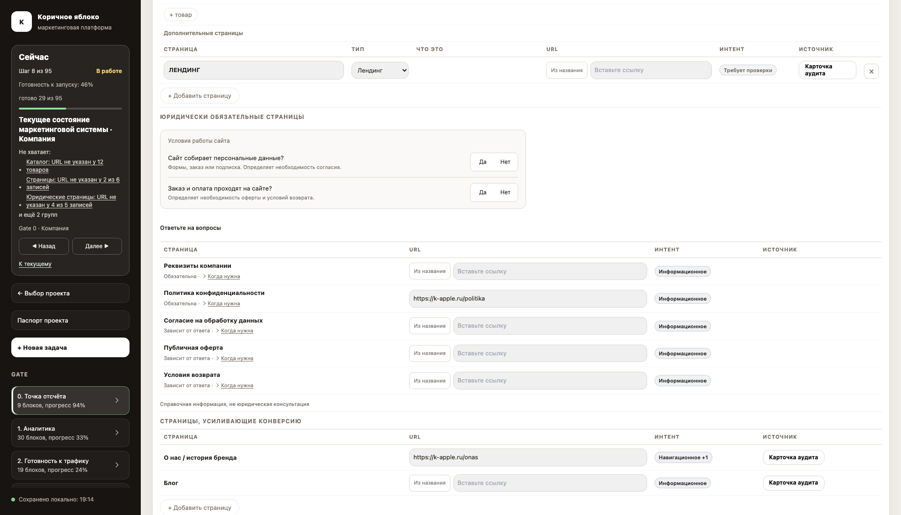

# Упрощение юридического блока

Сборка: `2.3.526+3bb7a5ca2a59`. Публикации не было.

## Что вызывало путаницу

Переключатели располагались у правого края широкой таблицы, далеко от текста вопросов. Текст «Нет данных» не объяснял, не хватает ли URL или ответа о необходимости страницы. Связь каждого вопроса с условными страницами не была видна. Несколько раскрытых юридических пояснений могли одновременно увеличивать высоту таблицы.

## Что изменено

- Два вопроса собраны в компактную группу «Условия работы сайта», максимальная ширина 780 px плюс внутренние отступы. Подписи постоянно видны, переключатели стоят рядом.
- Короткие пояснения показывают зависимость: сбор данных определяет необходимость согласия; заказ и оплата определяют необходимость оферты и возврата.
- До ответа условные страницы подписаны «Зависит от ответа». Значения расчёта необходимости остались прежними.
- «Когда нужна» имеет указатель раскрытия, индивидуальное доступное имя и состояние aria-expanded. Одновременно открыто одно пояснение в этом блоке. Пояснения и ссылки на источники сохранены.
- Поддерживается клавиатура; для фокуса есть контур. Выбранный вариант отмечен через aria-pressed и визуально.
- Таблица, четыре колонки, порядок строк, ввод URL, кнопки «Из названия», сводка и живое сохранение сохранены. Редактор URL не заменяется при обновлении.
- В этой правке новых полей или миграций нет. Используются прежние collectsPersonalDataV1 и siteCheckoutV1. Код расчёта ready/in_progress, URL-хранилища, других блоков и now-guide.js не менялся относительно предыдущего юридического блока.

Изменённые файлы: `app.js`, `styles.css`, `scripts/platform-legal-pages-smoke.mjs`. Дифф только этой итерации для app.js/styles.css: [changes.patch](changes.patch).

## Основания решения

Это применение рекомендаций Apple, а не готовый шаблон Apple:

- [Design principles](https://developer.apple.com/design/human-interface-guidelines/design-principles/): краткие подписи, ясная иерархия, привычные действия.
- [Layout](https://developer.apple.com/design/human-interface-guidelines/layout): группировка связанных элементов, различие основного и вспомогательного содержания.
- [Disclosure controls](https://developer.apple.com/design/human-interface-guidelines/disclosure-controls): второстепенные пояснения раскрываются рядом с относящимся к ним элементом, состояние раскрытия понятно.
- [Segmented controls](https://developer.apple.com/design/human-interface-guidelines/segmented-controls): связанные варианты имеют одинаковую ширину и явно показывают выбор.

## Проверка

`platform-legal-pages-smoke.mjs`: PASS на итоговой сборке. Проверены:

- отсутствие выбранных ответов и новых ключей при просмотре;
- связь подписей и пояснений с переключателями;
- компактность группы вопросов;
- варианты Да/Да, Нет/Нет и смешанный ответ, сводка, приглушение и редактируемость строк;
- одинаковые статусы блока и пути, ready при заполненных остальных требованиях и двух Нет;
- сохранение ответов в изолированном localStorage в памяти;
- отсутствие изменений данных при раскрытии справки, единственное открытое пояснение, Enter с клавиатуры;
- сохранение `#offer` и идентичность DOM поля;
- одинаковые названия, порядок строк и ширины колонок до, после и с открытой справкой: [523, 523, 231, 261];
- отсутствие ошибок Runtime.

`npm run build`: PASS, 42 согласованных ресурса. `node --check app.js`, `node --check scripts/platform-legal-pages-smoke.mjs`, `git diff --check`: PASS.

Исходный экспорт Коричного яблока до и после: `4df7d838dca5e8ea2d9112e5bf1a8ba69799d6a453546bd346c4bc7e4a76cc37`.

Экспорт браузерной копии при чтении до: `3ed866ef9b2ad56f399e835ffe7562129d0bc7f306f9fca9b443d7d310f96bf1`; после: `3ed866ef9b2ad56f399e835ffe7562129d0bc7f306f9fca9b443d7d310f96bf1`. Значения совпали. При обработке ответа изменяются только два прежних поля ответа; обычное автосохранение пользовательской правки отдельно обновляет штатные служебные метаданные. Рабочие проекты не редактировались, облачные обращения заглушены.

## Скриншоты

[До](01-before.png), [без ответов](02-unanswered.png), [оба Да](03-both-yes.png), [оба Нет](04-both-no.png), [пояснение](05-explanation.png).

## Не проверено

Другие проекты, полный набор smoke остальных гейтов, мобильный браузер и облачное сохранение. Юридические тексты в этой итерации не менялись и не проходили новую юридическую экспертизу.
