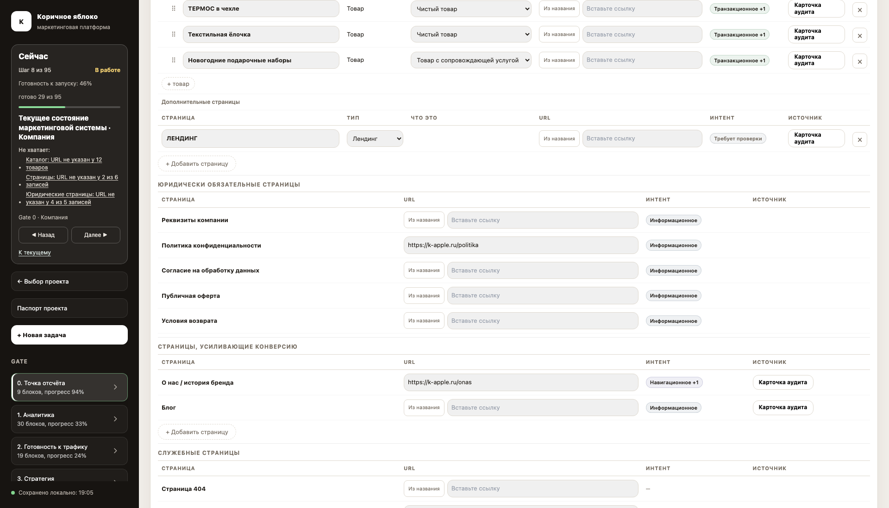
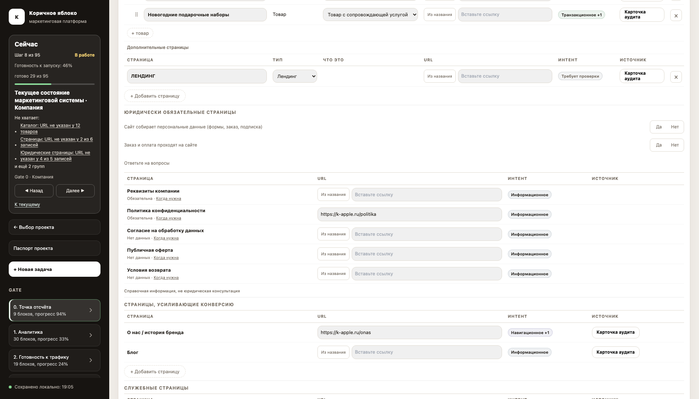
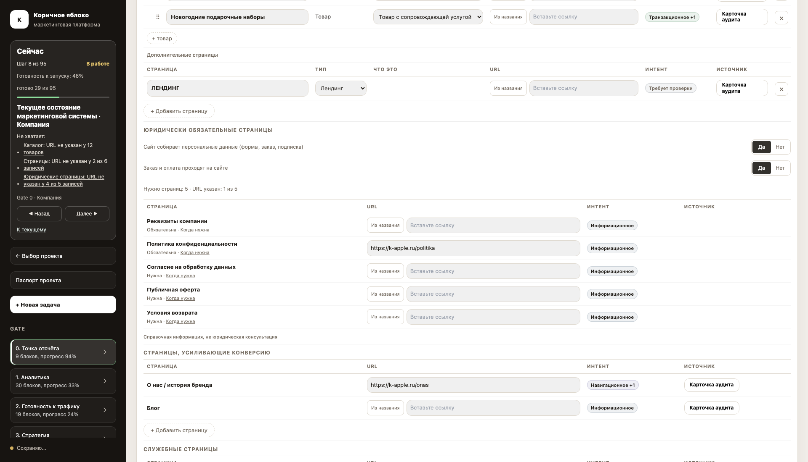
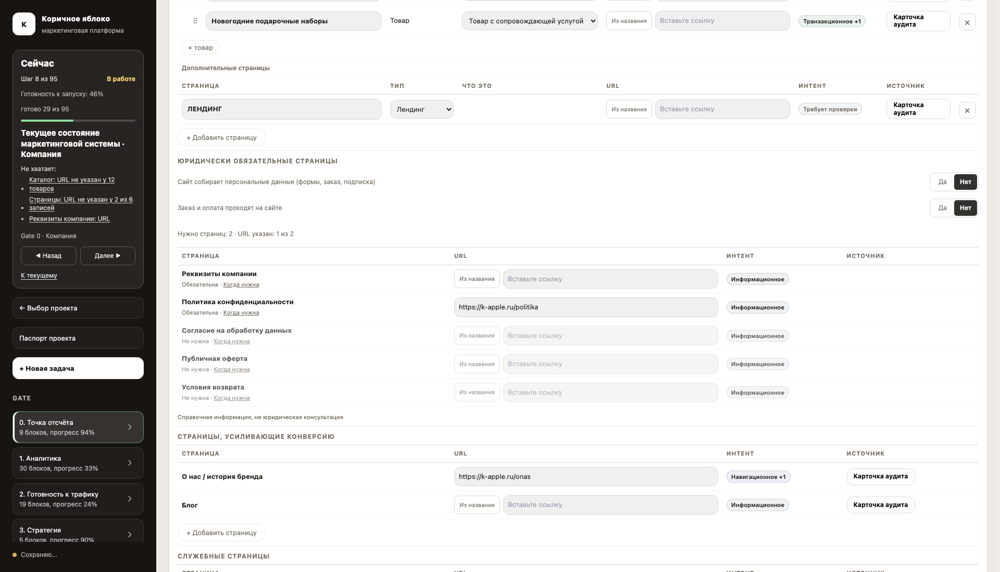
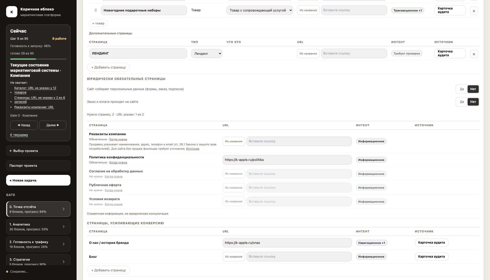

# Юридически обязательные страницы, Gate 0

## Версия и границы

- Коммит до работы: `4486bf9a78f1d482f69ad435fd1c5a2c96c890e6`.
- Локальная сборка: `2.3.526+31409fbefa7d`, отпечаток `31409fbefa7d`.
- Публикация и push не выполнялись.
- Изменены `app.js`, `styles.css`; добавлен `scripts/platform-legal-pages-smoke.mjs`. Доказательства находятся в `artifacts/legal-pages/`.
- Изменения ограничены юридической частью Платформы и её вкладом в существующий расчёт статуса card-7. Код других гейтов, SMM, РСЯ, Поиска и now-guide.js не менялся.

## Поля

Подходящих ответов в существующей модели Платформы не обнаружено. Используются два новых булевых поля:

- `gate-0.cards[card-7].megaMarketing.platformV2.collectsPersonalDataV1`
- `gate-0.cards[card-7].megaMarketing.platformV2.siteCheckoutV1`

Это проектный уровень, без привязки к выбранному product_id. Поля не создаются при чтении, миграции или показе подсказок. Каждое появляется только после ответа на соответствующий вопрос. Новых хранилищ нет. Ответ сохраняется штатным живым сохранением.

До ответа условные страницы имеют статус «Нет данных» и остаются потенциально нужными. Неотвеченные вопросы также не позволяют считать полностью заполненный блок готовым. «Не нужна» исключает страницу из единого расчёта недостающих URL, но не отключает редактор URL.

## Результаты

| Состояние | Нужных страниц | Заполненных URL | Приглушённых строк |
|---|---:|---:|---:|
| Без ответов | Итог «Ответьте на вопросы» | Исходные URL сохранены | 0 |
| Оба «Да» | 5 | 1 | 0 |
| Оба «Нет» | 2 | 1 | 3 |

В «Сейчас» до ответа: юридические URL отсутствуют у 4 из 5 строк. После двух «Нет» остаётся только «Реквизиты компании: URL». Исключённые три строки не попадают в подсказку. Когда в группе одна пустота, существующий механизм показывает конкретное поле вместо сводного пункта.

На отдельной копии, где остальные требования заполнены, два «Нет» и два обязательных URL дают `ready`. Два «Да» с пустыми условными URL или отсутствие ответов дают `in_progress`.

Таблица сохранила четыре колонки, порядок пяти строк и исходные URL. При ширине экрана 1920 px ширины колонок до правки, после и при открытом пояснении одинаковы: 523, 523, 231, 261 px. URL с `#offer` принят и сохранён; существующий DOM редактора не заменяется. «Когда нужна» открывается и закрывается; источники доступны отдельными ссылками. Приведённые пользователем пояснения сохранены с оговорками о юридической сверке.

## Данные

Все действия выполнены в отдельном браузерном контексте, localStorage заменён памятью, облачный API заглушён. Рабочий проект не редактировался.

- Исходный экспорт до и после всех проверок: `4df7d838dca5e8ea2d9112e5bf1a8ba69799d6a453546bd346c4bc7e4a76cc37`.
- SHA-256 браузерного экспорта до чтения: `cfac50db6d0ca715ebaabeccffa7cadc3afe25260497cb3580da36a6e6649f32`.
- После расчёта, подсказки и обновления юридической части: `cfac50db6d0ca715ebaabeccffa7cadc3afe25260497cb3580da36a6e6649f32`.
- При первоначальном показе новых ключей нет, ни один сегмент не выбран.
- Синхронная обработка ответов меняет только два новых поля: после их исключения полный JSON совпадает с состоянием до ответа. Живое сохранение этих ответов проверено отдельно. Как обычно, штатное сохранение пользовательской правки обновляет служебные метаданные сохранения; сравнение только двух новых ключей относится к обработчику ответа до этого сохранения.
- Существующий smoke Gate 0 отдельно подтвердил идентичность полного экспорта при просмотре, включая 259 полей времени: `a7c43126413147cdbf6cb99747512bc096145a8d34dfde453d5f0082336b93b2` до и после.

## Проверки

| Проверка | Результат |
|---|---|
| platform-legal-pages-smoke.mjs | PASS на 2.3.526+31409fbefa7d |
| seo-url-transliteration-smoke.mjs | PASS на 2.3.526+31409fbefa7d |
| gate0-unified-readiness-smoke.mjs | PASS; все 9 значков равны статусам пути; запуск после правки логики, до финальной правки переноса текста CSS, сборка 2.3.526+9a2bf65190e0 |
| node --check app.js и новый smoke | PASS |
| git diff --check | PASS |
| npm run build в временной копии | PASS, 42 согласованных ресурса, 2.3.526+31409fbefa7d |

Браузерные smoke выполнялись последовательно. Ошибок Runtime в новом smoke и проверке URL нет. Полные результаты и команды настройки окружения доступны в тестах, логи рядом с отчётом.

## Скриншоты

### До изменения

### После изменения, до ответов, подсказка «Сейчас» до ответа

### Оба «Да»

### Оба «Нет», подсказка «Сейчас» после ответа

### Открыто «Когда нужна»

## Что не проверено

- Другие проекты и полный набор smoke других гейтов.
- Облачное сохранение, продакшен и мобильный браузер.
- Юридическая достаточность пояснений и документов. Тексты справочные, с сохранёнными оговорками пользователя. Источники открыты: [Роспотребнадзор](https://44.rospotrebnadzor.ru/zacshita_prav_potreb/1671/), [Saby](https://saby.ru/articles/contragents/kak_vypolnit_trebovaniya_zakona_o_persdannyh_na_sayte).
