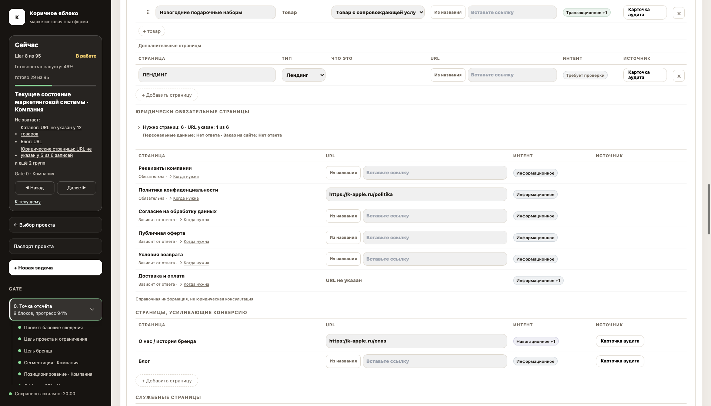
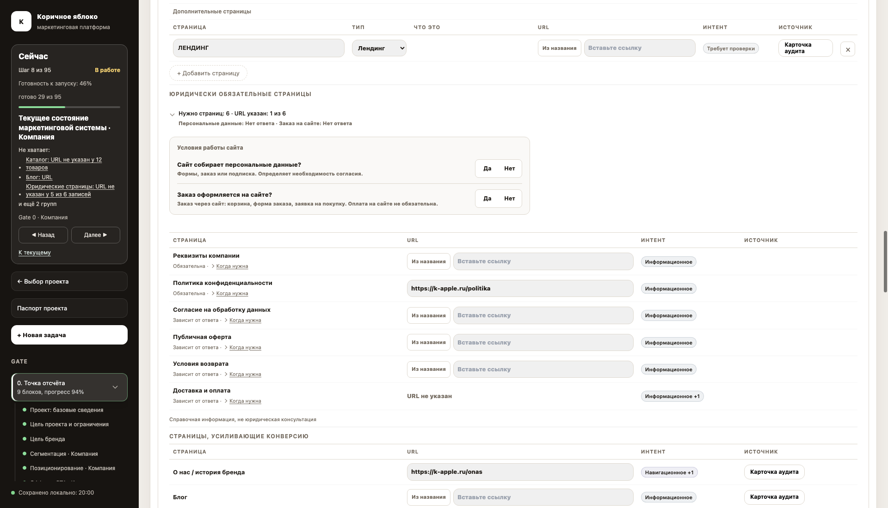
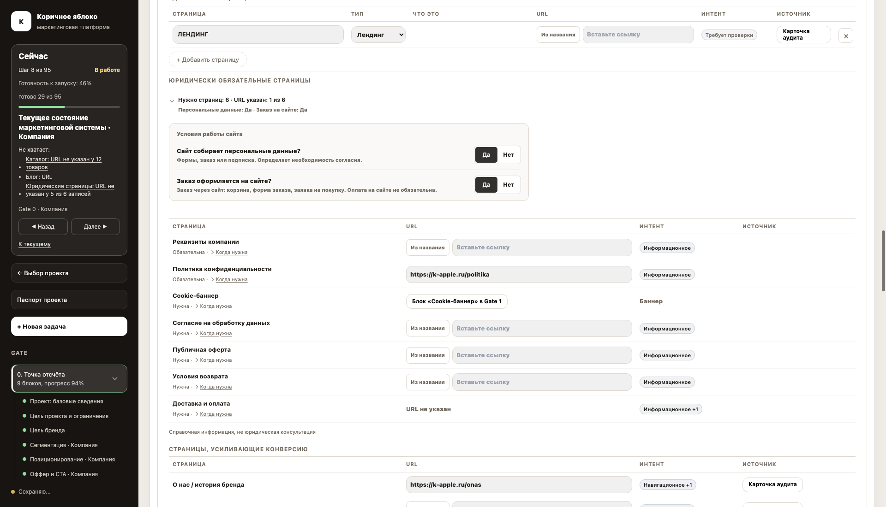
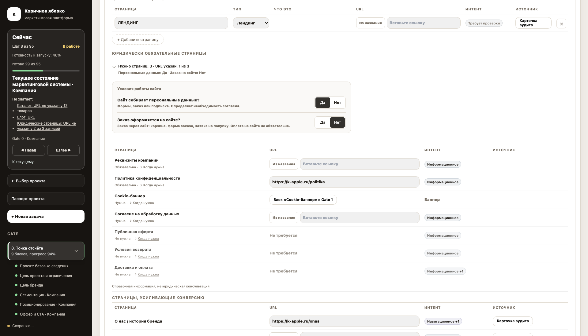
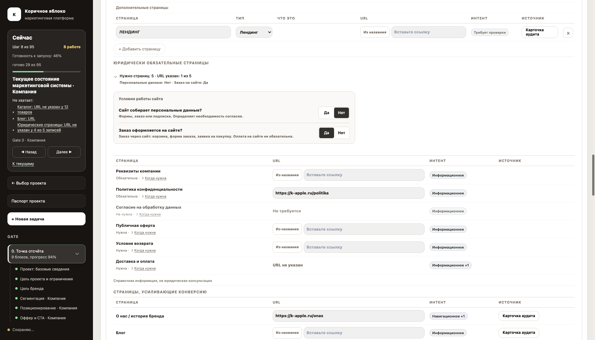
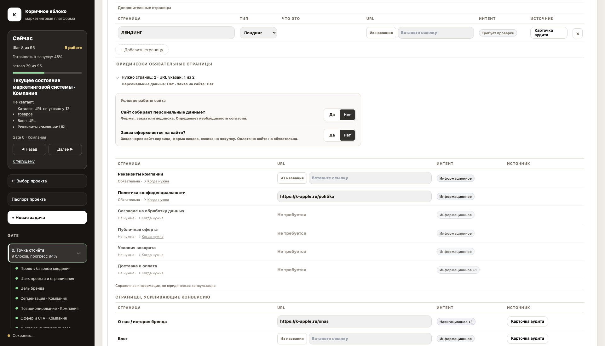

# Согласованная структура юридических страниц, Gate 0

Локальная сборка: `2.3.526+d8a3a0c209c5`. Сравнение выполнено с копией перед этой задачей: `2.3.526+2ed02ce31302`. Push и публикации не было.

## Реализация

- Итог стал нативным details/summary, по умолчанию закрытым. Первая строка содержит N/K, вторая показывает оба ответа. В отсутствие сохранённого ответа используется «Нет ответа», значение не подставляется и не записывается. Тексты вопросов и подсказок сохранены. Открытие хранится только в DOM.
- Порядок: Реквизиты, Политика, Cookie-баннер (при Да о данных), Согласие, Оферта, Условия возврата, Доставка и оплата.
- Cookie-баннер содержит существующий переход `data-open-audit-page="card-35"`, интент «Баннер». Он отсутствует при ответе Нет или без ответа, не входит в N/K, проверки URL или готовность Gate 0. Код Gate 1 не менялся.
- Доставка читает тот же `platformV2.urlsV1.fixed.delivery`, что и фундаментальный редактор. Второго ввода нет. При Да она входит в N/K и готовность, при Нет исключена из юридических и общих требований Платформы. До ответа сохраняется прежняя осторожная проверка URL. Изначальный редактор остаётся на месте.
- Строки «Не нужна» содержат «Не требуется» вместо редактора. Значения URL не удаляются. Изменение ответа обратно возвращает редактор с прежним значением.
- Добавлены `deriveLegalPages(workspace)` и отрисовка `megaPlatformLegalHtml()`. Список, обязательность, URL, N/K, итог, ответы, готовность и диагностические проверки формируются моделью derive. В модели нет ensure-инициализации, кэша, вызовов сохранения или изменений входного объекта.
- `megaMarketingStatus()` использует диагностические проверки модели. Доставка исключена из прежнего общего URL-списка и учитывается ровно один раз через модель. «Сейчас» получает эти же проверки существующим механизмом; now-guide.js не менялся.
- Интенты юридических строк используют прежний общий рендерер в защищённом проходе `guruReadinessInspect`, с временной копией для старой нормализации. Этот путь не изменяет исходные записи и не планирует их сохранение.
- `megaPlatformSetUrl()` сравнивает нормализованное значение до инициализации URL-хранилища. Неизменившееся значение возвращает false. `updateMegaMarketing()` останавливается до пересчёта и сохранения при таком результате. Проверка одинакового ответа Да/Нет сохранена.

Ключи `collectsPersonalDataV1`, `siteCheckoutV1` и URL-хранилища остались прежними. Миграций нет. Остальные блоки и таблицы, SMM, РСЯ, Поиск и код гейтов 1-8 не редактировались. Общий рендерер интентов получил необязательный аргумент workspace для защищённого юридического вызова; прежние вызовы по умолчанию работают как раньше. Общий редактор URL получил необязательное заранее прочитанное значение.

Изменённые файлы этой задачи: `app.js`, `styles.css`; добавлен `scripts/platform-legal-structure-smoke.mjs`. [Дифф относительно начала задачи](changes.patch).

## Коричное яблоко: сравнение до/после

Исходные ответы в экспорте отсутствуют. После просмотра они также отсутствуют. В обоих вариантах Gate 0: 9 блоков, 8 готовых, 94%. Текущий шаг: 8 из 95, card-7, статус in_progress. Статусы всех девяти блоков совпали.

N/K в таблице ниже относятся к новому юридическому списку. Сравнение процента и шага выполнено на одинаковых копиях для каждой комбинации.

| Персональные данные | Заказ | N | K | Gate 0 до / после | Шаг до / после |
|---|---|---:|---:|---|---|
| Да | Да | 6 | 1 | 94% / 94% | 8 из 95 / 8 из 95 |
| Да | Нет | 3 | 1 | 94% / 94% | 8 из 95 / 8 из 95 |
| Нет | Да | 5 | 1 | 94% / 94% | 8 из 95 / 8 из 95 |
| Нет | Нет | 2 | 1 | 94% / 94% | 8 из 95 / 8 из 95 |

Объяснение изменений по каждой комбинации:

- Да / Да: доставка включена в юридический N/K, ранее проверялась в общем URL-списке. Количество требований готовности не увеличилось, двойного подсчёта нет. Процент и шаг совпали.
- Да / Нет: отсутствующий URL доставки исключён из «Не хватает» и готовности. Другие пустоты сохраняют in_progress, процент и шаг совпали.
- Нет / Да: доставка включена в юридический N/K вместо прежнего общего списка. Процент и шаг совпали.
- Нет / Нет: отсутствующий URL доставки исключён из «Не хватает» и готовности. Другие пустоты сохраняют in_progress, процент и шаг совпали.

На этой копии заполнена только политика, поэтому K=1 во всех четырёх комбинациях. Cookie-баннер не влияет на счётчики и статус при любом ответе.

## Проверки

| Проверка | Результат | Время |
|---|---|---|
| gate0-merged-readiness-smoke.mjs | PASS | 20.608 с |
| gate0-now-missing-smoke.mjs | PASS | 34.348 с |
| gate0-unified-readiness-smoke.mjs | PASS | 32.124 с |
| platform-legal-structure-smoke.mjs | PASS | см. structure-smoke.log |
| npm run build во временной копии | PASS, 42 согласованных ресурса | build.log |
| node --check и git diff --check | PASS | локально |

Целевая проверка подтвердила:

- чистый расчёт всех четырёх комбинаций на рекурсивно замороженных объектах;
- готовность модели при заполненных требуемых URL, в том числе когда часть страниц не нужна;
- отрисовка `megaPlatformLegalHtml()` оставляет полный JSON входного состояния неизменным;
- раскрытие итоговой строки не меняет JSON в обработчике;
- прежние ответы до/после и все четыре комбинации дают согласованные проценты и шаги;
- редактор доставки существует в одном экземпляре в фундаментальных страницах, в юридической строке редактора нет;
- сохранность полного URL-хранилища при переключении четырёх комбинаций;
- статичные строки «Не требуется» без полей ввода;
- повторные input/change без изменения URL: 0 вызовов сохранения, JSON идентичен;
- изменённый URL с последующим change: 1 вызов сохранения, ссылка с # принята, DOM поля сохранён;
- повторный клик по выбранному ответу не добавляет сохранение;
- отсутствие ошибок Runtime.

Штатные smoke отдельно сравнивают экспорт при просмотре и переходах, включая поля времени. Предыдущая дополнительная проверка смешивала в одном raw JSON-снимке измерения, навигацию и временную подготовку ответов. Её неподтверждённый вывод не использован как доказательство записи от рендера. Здесь чистота модели и юридического компонента проверена на явных границах вызовов, а навигация проверена тремя штатными smoke.

Рабочий проект не редактировался. Проверки выполнены в изолированных браузерных контекстах на копиях, облачный API заглушён. Исходный экспорт на диске до/после идентичен: SHA-256 `4df7d838dca5e8ea2d9112e5bf1a8ba69799d6a453546bd346c4bc7e4a76cc37`.

## Скриншоты

## Что не проверено

Другие проекты, мобильный браузер, облачное сохранение и полный набор тестов других гейтов. Переход к Cookie-баннеру использует существующий обработчик открытия card-35; отдельный браузерный сценарий его открытия в Gate 1 не выполнялся. Полная чистота старых нормализаторов за пределами юридического компонента отдельно не аудировалась; запрошенные smoke переходов и экспорта прошли.
